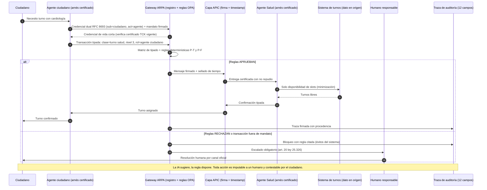

# ARPA — Arnés Referencial Provincial de Agentes de IA

**Provincia de Santa Fe · Eje 9 (Ciencia, Tecnología, Innovación e IA) · Matriz de diagnóstico Santa Fe y Rosario**

---

## 1. Título

**ARPA: Arnés Referencial Provincial de Agentes de IA — calidad, trazabilidad y responsabilidad verificable en toda transacción con agentes de IA del Estado santafesino, sobre el sustrato APIC (Autopista Provincial de Información Confiable).**

## 2. Resumen

ARPA es una infraestructura normativo-técnica que define **cómo los agentes de IA pueden actuar dentro del Estado provincial**: qué identidad deben portar (siempre vinculada criptográficamente a un responsable humano), qué mandato los autoriza, qué clases de transacciones pueden ejecutar según la sensibilidad de los datos involucrados, qué reglas determinísticas los restringen en tiempo de ejecución, y qué certificación provincial (suite de conformidad TCK) deben aprobar antes de operar o de ser contratados.

Funciona como un **arnés global que encorseta a todos los arneses locales**: cada organismo, municipio o proveedor puede usar el stack de agentes que prefiera, pero para transaccionar con la Provincia debe conformar con ARPA. La circulación de la información se apoya en APIC, una capa de intercambio descentralizada estilo X-Road (el dato queda en el organismo dueño; los mensajes van firmados, sellados con tiempo y registrados con no repudio).

Es el **primer instrumento público subnacional de este tipo**: la revisión sistemática de literatura (77 papers, 2023-2026) y el estado del arte industrial (28 componentes) verificaron que ningún marco existente integra identidad dual + mandato + tipado de transacciones + enforcement determinístico + certificación + auditoría no repudiable, y que la certificación de conformidad de agentes está vacía a nivel global. Santa Fe puede implementarlo **sin ley nueva** (ley provincial 14.256/2024, Decreto 2726/2025, ley 25.506 de firma digital) y apoyado en la ID Ciudadana obligatoria desde julio de 2026.

## 3. Problema que soluciona

**Hecho comprobado (fuentes en documentos de respaldo):**

1. **Los agentes de IA están entrando al Estado sin identidad ni control.** No existe en Santa Fe un registro transversal de sistemas de IA, ni marco público de evaluación de riesgos, auditoría y revisión humana (nudo crítico #4 del diagnóstico del Eje 9). Cuando un agente consulta, tramita o decide, hoy nadie puede responder criptográficamente *quién actúa, bajo qué mandato, y quién responde*.
2. **La información sensible circula por canales ad hoc.** Santa Fe es la provincia más grande de Argentina sin Ecosistema Digital de Integrabilidad (hay 7 operativos: CABA, Neuquén, Mendoza, Chaco, Catamarca, Santiago del Estero, Río Negro). Sin capa provincial, cada sistema con IA consulta datos sensibles por planillas, convenios bilaterales o APIs de proveedor (nudo #6: dependencia y opacidad).
3. **Los fracasos están documentados y ocurrieron justo donde ARPA pone el control.** MyCity (chatbot municipal cancelado por respuestas erróneas en fronteras no tipadas), Tessa/NEDA (sistema modificado por el proveedor por debajo de su dueño), CABA-Gemini (IA en primaria sin tipado por edad). Evidencia de mercado: ningún agente comercial supera el 60% en Agent-SafetyBench; Gartner proyecta >40% de proyectos agénticos cancelados a 2027 y detecta "agent washing" (solo ~130 vendors agénticos reales de miles anunciados).
4. **La ley ya manda lo que la infraestructura no habilita.** La ley 14.256/2024 exige protocolos de accesibilidad a datos y once-only (art. 26 y 42); la Constitución provincial reformada (art. 29) y el Decreto 2726/2025 exigen auditabilidad y protocolo de IAG. Sin tipado, reglas y trazas, esos mandatos son incumplibles en la práctica para transacciones con agentes.
5. **Nadie certifica agentes en el mundo.** La conformité (TCK) para implementaciones agénticas es un nicho vacío: AAIF certifica personas, ISO 42001 organizaciones, NIST evalúa por acuerdos bilaterales. Sin certificación, la compra pública no puede distinguir un agente seguro de marketing.

## 4. Objetivo general

Garantizar la **calidad del tipo de información y del tipo de transacciones** que se desarrollan con agentes de IA en el sector público santafesino, mediante un arnés referencial provincial único, verificable y certificable, que haga a toda acción automatizada **identificable, autorizada, tipada, restringida por reglas determinísticas, registrada con no repudio y auditable**, con un responsable humano siempre imputable.

## 5. Objetivos específicos

1. **Crear ARPA por decreto** como régimen provincial obligatorio para el Poder Ejecutivo y por adhesión para municipios, universidades y proveedores (consecuencia jurídica por transaccionar fuera del arnés — modelo Neuquén art. 7 Ley 3290).
2. **Aprobar el Diccionario Provincial de Sensibilidad de Datos** (5 niveles: 0 público → 4 crítico) como protocolo de la ley 14.256 art. 42, con vector de metadatos firmado por servicio y candados anti-sobre-clasificación.
3. **Definir la matriz de tipado de transacciones**: clase de transacción × nivel de sensibilidad × rol del agente → requisitos de enforcement (credencial dual, humano en el loop, evaluación de impacto, reglas aplicables).
4. **Construir el TCK provincial** (suite de conformidad por clase de amenaza sobre Inspect, metodología τ-bench + AgentHarm adaptados a trámites santafesinos) y el **registro público de agentes y arneses certificados**.
5. **Condicionar la compra pública a certificación ARPA**: conformidad TCK como condición de adjudicación y pago en todo pliego con componentes agénticos (primer caso: licitación Res. 150/2026, USD 5,37M en plataformas con IA), con control de cambios de proveedor y recertificación obligatoria.
6. **Poner en producción 3 pilotos** con catálogo cerrado de 3-5 trámites sobre ID Ciudadana (salud, once-only interministerial, y analítica de video de Rosario como test de máximo nivel), sin chat abierto.
7. **Implementar la traza de auditoría enforcement-ready de 12 campos** (log append-only firmado con PKI ley 25.506, independiente del agente) y el **panel público de métricas** con fecha de corte y columna declarada-vs-auditada.
8. **Federar**: convenios con CABA (X-BA), Neuquén (OPTIC) y mesa FederAI/CAF; horizonte de federación nacional y puente a dataspaces UE (Gaia-X ya contempla agentes como trust scope).

## 6. Alcance

**Dentro del alcance:**
- **Jurisdiccional:** Poder Ejecutivo provincial y organismos descentralizados (obligatorio); 365 municipios y comunas por adhesión con fondo de adecuación (Rosario primero); universidades (UNR, UNL, UTN), Poder Judicial y Nación por federación; proveedores privados vía contratación pública.
- **Sectorial:** trámites gubernamentales y servicios al ciudadano, salud pública, educación provincial, tramitaciones administrativas interorganismos (once-only).
- **Técnico:** todo agente de IA que consulte, intercambie o transaccione datos del Estado provincial; todo arnés local (runtime de agentes de organismos/proveedores) que busque certificado; la capa de circulación APIC como sustrato mandado.
- **Población:** ~3,5 millones de habitantes (todo trámite que requiera datos en poder del Estado).

**Fuera del alcance (declarado explícitamente — "el arnés gobierna el sobre, no la carta"):**
- La verdad o corrección semántica del contenido generado por los agentes (no es garante de que una respuesta sea correcta, sino de que sea identificable, autorizada, tipada y auditable).
- Sesgo y equidad de los modelos (se atacan por evaluación de impacto y auditoría, no por el arnés).
- Decisiones que afectan derechos: siguen prohibidas sin humano en el loop (art. 20 ley 25.326 y Medida 5).
- Reemplazo de sistemas existentes: ARPA no migra ni reescribe sistemas; regula la interfaz.
- Agentes privados que no transaccionen con el Estado (el arnés llega vía compra pública y registro, no vía prohibición general).
- Niveles 3-4 sin ley habilitante por intercambio (ley 25.326 art. 7).

## 7. Ventajas

1. **Novedad verificada:** primer instrumento público subnacional que integra las 6 piezas; el nicho de certificación (TCK) está vacío a nivel global → Santa Fe pionera real en ALC, no de vitrina (los "agent IDs" de Estonia siguen en plan).
2. **Sin ley nueva:** habilitado por ley 14.256/2024 (arts. 26, 39, 42), Decreto 2726/2025, ley 25.506, art. 29 CN provincial; el decreto puede firmarse en los primeros 100 días.
3. **Prerrequisitos ya existentes:** ID Ciudadana obligatoria (07/2026), régimen de compra pública de innovación de Rosario (el más avanzado del país), ecosistema CyT denso (CONICET, UNR, UNL, UTN, CAETI) capaz de construir el TCK.
4. **Soberanía y anti-dependencia (nudo #6):** stack open source (SPIRE, OPA, Langfuse self-hosted, X-Road), hosting local, AWS/Azure excluidos como dependencia estructural (sin región Argentina), cláusulas de salida, certificación portable entre proveedores → rompe lock-in.
5. **Responsabilidad por construcción:** credencial dual (RFC 8693: sub=humano, act=agente) hace toda acción imputable a una persona; logging no repudiable habilita contestabilidad ciudadana y validez judicial.
6. **Integra lo existente:** da techo y mecanismo ejecutable a las 8 medidas de gobernanza de IA ya formuladas en el Eje 9 (registro, clasificación de riesgo, plataforma, pliegos, supervisión humana, formación, encuesta, auditoría).
7. **Palanca económica inmediata:** condicionar la licitación Res. 150/2026 (USD 5,37M) a certificación convierte la primera compra grande en el primer caso de aplicación.
8. **Escalable y proporcional:** arnés ligero para niveles 0-1, pleno para 3-4; los municipios no construyen nada propio, se adhieren.

## 8. Desventajas y riesgos (honestos)

1. **Requiere capacidad técnica que hay que construir:** el TCK es ingeniería real (suites de prueba, metodología τ-bench, gente que escriba Rego bien — escasez documentada). Mitigación: CAETI/UNR/CONICET + especificación v0 en 100 días.
2. **No garantiza corrección semántica:** si se comunica como "IA segura y correcta" será refutado; el alcance "sobre/carta" debe declararse por norma. Riesgo de sobre-promesa jurídica si no se declara.
3. **Overhead y latencia:** enforcement determinístico + logging firmado agrega milisegundos por transacción (evidencia: 0,049-0,189 ms por verificación en patrones IBCT — acotado, pero existe). Mitigación: arnés proporcional por nivel.
4. **Churn de estándares:** WIMSE en draft, MCP Registry en preview, OTel GenAI con 0 de 63 atributos estables. Mitigación: componer solo estándares estables (SPIRE, RFC 8693, MCP 2026-07-28, A2A v1.0.x endurecido), revisión semestral, pliegos sin números de draft.
5. **Rendimiento en español no validado** de guard models (Llama Guard 4 optimizado para inglés): el carril probabilístico es secundario por diseño, pero los pilotos deben validar localmente.
6. **Continuidad política / "champions":** los EDIs argentinos dependen de referentes personales; un cambio de gestión puede vaciarlo. Mitigación: institucionalización por norma en ASaCTeI/Unidad de Gestión, no por programa.
7. **Riesgo de sobre-clasificación:** el diccionario puede usarse para opacidad (precedentes: Decreto 780/2024, Estonia "internal use"). Mitigación: catálogo cerrado de niveles, expiración automática, registro público de reservas con metadatos.
8. **Resistencia a la adopción:** organismos y proveedores preferirán evitar la certificación. Mitigación: palanca de compra pública + efecto jurídico + catálogo cerrado inicial (3-5 trámites, no todo el Estado el día 1).
9. **El eslabón débil municipal:** sin línea base verificada y fondo de adecuación, las vulnerabilidades periféricas se propagan (lección "Wild West" estonia).

## 9. Tareas para cumplir los objetivos

### Fase 0 — Gobernanza (días 1-100, sin costo de infraestructura)
1. Decreto de creación: comité interministerial ARPA + secretaría técnica en Secretaría CTI/ASaCTeI + puesta en marcha de la Unidad de Gestión de la ley 14.256 (cuya constitución no fue localizada) con plazo fijo de reglamentación.
2. Resolución que adopta: los 10 Design Tenets de NIST como política de identidad agéntica, el patrón de credencial dual RFC 8693, el esquema de traza de auditoría de 12 campos y el stack de referencia (SPIFFE/SPIRE + OPA + A2A/MCP endurecidos + Langfuse self-hosted).
3. Convenios de cooperación y federación: CABA (X-BA) y Neuquén (OPTIC); observador en mesa FederAI/CAF y caso de uso federal Redam.
4. Instructivo de cláusulas ARPA en pliegos (con Medida 4): conectividad a la capa, firma+timestamp, logs locales, vector de sensibilidad, credencial dual, Agent Cards firmados, recertificación ante cambios, salida ordenada. Aplicar a la licitación Res. 150/2026.
5. Borrador de la especificación TCK v0 (sobre Inspect) para consulta con UNR/UNL/UTN/CONICET/CAETI.
6. Compromiso público de métricas: panel con fecha de corte obligatoria y línea base (qué existe hoy).

### Fase 1 — Semántica (meses 3-12)
7. Encuesta de tipos de información a 10 organismos grandes (salud, gobierno, justicia, educación, desarrollo social, registro civil, seguridad, producción, hacienda, Rosario).
8. Aprobación del Diccionario de Sensibilidad (5 niveles + tabla de tratamiento + vector de metadatos con campo `ia_autorizada` + candados anti-sobre-clasificación), validado con UNR/UNL Derecho e Informática y AAIP.
9. Matriz de tipado de transacciones v1 para el catálogo cerrado de 3-5 trámites sobre ID Ciudadana (ej. certificado de domicilio, turnos de salud, constancia de alumno regular).
10. Reglas OPA/Rego provinciales por defecto (políticas P-T y P-F del patrón CaMeL adaptadas), con pipeline regulación→regla de revisión humana certificada (patrón ShieldAgent/OpenFisca-NSW).

### Fase 2 — Infraestructura mínima (año 1-2)
11. Despliegue del sustrato APIC: servidor central + CA/TSA (X-Road open source o conector compatible), primer security server piloto, portal administrativo (modelo PGSI de CABA), allowlist/registro provincial privado de agentes y servidores MCP.
12. Construcción del TCK v1: suites por clase de amenaza (inyección indirecta, colusión, fallos no adversariales) con metodología τ-bench (pass^k + estado final de DB + reglas de dominio) + red-team AgentHarm adaptado; certificados por categoría, no sello único.
13. Línea base municipal + fondo de adecuación (convocatorias ASaCTeI); verificación efectiva, no declarada.
14. Portal de trazabilidad ciudadano (modelo Data Tracker estonio): cada persona ve quién consultó sus datos y con qué justificación.

### Fase 3 — Pilotos certificados (año 2-3)
15. Piloto 1 Salud: trámites tipados nivel 3 con arnés local certificado, humano en el loop para toda decisión clínica (patrón Estonia-salud).
16. Piloto 2 Once-only interministerial: documentos que el ciudadano deja de presentar, métrica pública fechada.
17. Piloto 3 Rosario (test nivel 4): analítica de video con solicitud de documentación mínima, prohibición de agentes autónomos, watchdog con checklist de taxonomía Microsoft; tipado por edad si toca educación (lección CABA-Gemini: consentimiento parental, límites de sesión, transcripciones a docentes).
18. Evaluación ex ante y ex post por piloto con métrica de éxito y plan de retiro; primera auditoría externa al cierre del año 2.

### Fase 4 — Escala y federación (años 3-8)
19. Certificación obligatoria como condición de compra pública en todo pliego agéntico; recertificación ante cambio de modelo/reglas/arquitectura del proveedor.
20. Expansión progresiva del catálogo de transacciones y adhesión de municipios (obligatoriedad activada por organismo cuando su nodo cumple la línea base, no por fecha calendario).
21. Federación plena: X-BA, Neuquén, Río Negro, Chaco, Mendoza, Nación (Interoperar), caso de uso federal propio tipo Redam.
22. Puente internacional: Gaia-X Trust Protocol perfilado (agentes como trust scope), EHDS/OOTS para salud.
23. Eventual ley provincial de ecosistema que consolide el decreto (horizonte Neuquén: reglamento primero, ley como consolidación).
24. Mejora continua institucionalizada: revisión semestral de estándares y diccionario, auditoría externa anual (Medida 8), encuesta anual de adopción que cace "shadow AI" fuera del arnés (Medida 7).

## 10. Diagrama de secuencia — caso de uso emblemático

**Caso elegido:** *turno de salud solicitado por un agente personal del ciudadano* (transacción tipada de nivel 3 sobre ID Ciudadana). Muestra el recorrido completo del arnés: credencial dual, verificación de certificado TCK, tipado de la transacción, reglas determinísticas, circulación firmada por APIC con el dato quedando en el organismo dueño, y los dos desenlaces posibles (aprobación con traza de auditoría / rechazo con escalado humano obligatorio).

Imagen renderizada: `EJE_9_ARPA_diagrama_secuencia.png` (generada desde el fuente Mermaid siguiente).

**Lectura del diagrama:** los pasos 1-5 concentran el control previo (identidad, mandato, certificado y tipado); el paso 6 es la decisión determinística; los pasos 7-13 son el camino feliz con el dato quedando en el organismo dueño (principio X-Road) y minimización; los pasos 14-16 son el camino de rechazo, donde el bloqueo se registra con la regla citada y **toda denegación que toque derechos escala a un humano**. La traza de 12 campos (paso 13) es la que habilita auditoría independiente y contestabilidad ciudadana.

## 11. Beneficios y propuesta de valor

Separación honesta: ventajas **verificadas con números en otras jurisdicciones** (fuentes en los documentos de respaldo) vs. **incentivos propuestos por el eje** (propuesta, no hecho comprobado). Para Santa Fe la línea base aún no existe: la encuesta F0 a 10 organismos la construye.

### 11.1 Para el ciudadano

1. **Dejar de ser el correo del Estado** (once-only): en Neuquén se emitieron 1,7M de e-fotocopias y 16,1M de consultas interorganismos (2010-2023) — cada una es un viaje, una fila y un costo evitado. En la UE, el OOTS cubre 255 procedimientos con este principio desde 2023.
2. **Trámites conversacionales 24/7**: el patrón Estonia (2,4 mil millones de transacciones/año, 99% de e-servicios) y Diia.UA (catálogo cerrado de trámites por agente).
3. **Saber quién miró sus datos**: portal de trazabilidad ciudadano — en Estonia el Data Tracker permitió detectar consultas ilegales reales; Río Negro lo consagró como derecho (Ley 5793, art. 7.e).
4. **Privacidad por diseño**: el dato sensible queda en el organismo dueño (sin superbase hackeable), la consulta es mínima (el sistema de turnos ve slots, no historia clínica) y cada acceso va firmado y justificado.
5. **Nunca rechazado solo por una máquina**: toda denegación que toque derechos escala a un humano responsable identificable (art. 20 ley 25.326 + credencial dual); toda acción es imputable y reclamable.
6. **Chatbots que no inventan**: agentes certificados sobre catálogo cerrado de transacciones tipadas (anti-caso MyCity, cancelado por respuestas erróneas).

### 11.2 Para la institución / organismo

1. **Datos autoritativos reutilizables**: deja de pedir lo que otro organismo ya tiene; menos ventanilla y carga manual.
2. **Seguridad jurídica**: intercambio firmado + sellado con no repudio y validez probatoria (Neuquén Ley 3290 art. 7: lo intercambiado fuera del ecosistema pierde valor); la traza de 12 campos defiende al organismo en auditorías y juicios.
3. **Interoperar sin proyecto de integración**: cada organismo conserva su sistema, solo agrega un conector (X-BA alcanzó 98 servicios y 587 casos de uso con este modelo).
4. **IA con guardrails incluidos**: la provincia provee arnés, reglas y certificación — el organismo no inventa gobernanza; reduce el riesgo de caer en el >40% de proyectos agénticos que Gartner proyecta cancelados a 2027.
5. **Detección de irregularidades**: watchdogs sobre trazas hacen visible la sobre-consulta y el acceso indebido.
6. **Métricas reales de gestión**: volumen, tiempos, incidentes por servicio, con fecha de corte y columna declarada-vs-auditada.

### 11.3 Para municipios y proveedores

- **Municipios**: no construyen infraestructura propia — se adhieren con **fondo de adecuación** (lección del "Wild West" estonio: el eslabón débil se financia). Rosario acopla su régimen de compra pública de innovación (Ord. 10.264/2021 + Dec. 274/2026) como palanca.
- **Proveedores**: reglas de juego únicas provinciales en vez de N requisitos por organismo; el **certificado TCK es un activo comercial** que distingue del "agent washing" (Gartner: ~130 vendors agénticos reales de miles anunciados); certificación **portable** a provincia, municipios adheridos y futura federación (X-BA, Neuquén, Nación, horizonte Gaia-X).

### 11.4 Incentivos propuestos para hacer atractiva la adopción (propuesta, no hecho comprobado)

1. **Certificación gratuita el primer año** + sello público "Arnés Certificado Santa Fe" para proveedores early-adopters.
2. **Prioridad en convocatorias ASaCTeI** y en la licitación Res. 150/2026 (USD 5,37M) para quienes certifiquen primero — la zanahoria antes del garrote.
3. **Fondo de adecuación municipal** canalizado por TecPRO/ASaCTeI para los primeros 10 municipios adheridos.
4. **Catálogo cerrado inicial de 3-5 trámites de alta visibilidad** sobre ID Ciudadana (certificado de domicilio, turno de salud, constancia de alumno regular): victorias rápidas y medibles, no infraestructura abstracta.
5. **Meta pública cuantificada desde el día 1**: "documentos que el ciudadano dejó de presentar" como métrica insignia del once-only, con metodología publicada (contra-modelo: los "41.575 días ahorrados" de X-BA sin metodología verificable).

### 11.5 Regla de comunicación

Presentar siempre en este orden: "esto es lo que Neuquén, Estonia y la UE lograron con esta arquitectura (verificado) → esto es lo que Santa Fe puede esperar (proyección declarada) → esto es lo que mediremos para que usted lo verifique (compromiso público)". Convierte al escéptico en auditor y hace la propuesta refutable — que es exactamente lo que la vuelve seria.

---

*Documento de respaldo completo (evidencia, fuentes, 77 papers revisados, 28 componentes industriales, 21 casos sectoriales): `ARPA_ESTADO_DEL_ARTE_CONSOLIDADO.md` y `MEDIDA_9_APIC_INFORME.md`. Propuesta del Eje 9 — no constituye diagnóstico comprobado ni compromiso institucional.*

---

## 12. Adenda 31/10/2026 — convergencia Asia-Pacífico (anexo 12)

Investigación posterior a la aprobación (186 fuentes verificadas en China y Japón, corte 31/10/2026; detalle completo en `EJE_9_CHINA_JAPON_2026.md`):

1. **China** publicó la serie **GB/Z 185** (may-jul 2026, 7 documentos: arquitectura de interconexión de agentes, código de identidad, gestión de identidad) y ya emite códigos de identidad de agente ("身份码", trazabilidad 可管可控可溯): el análogo normativo más cercano a ARPA. Su filing CAC (1.112 servicios generativos + 731 apps al 31/08/2026, >5.000 algoritmos, consultable en beian.cac.gov.cn) es la Medida 1 a escala nacional — con la diferencia crítica de que opera como permiso de facto con evaluador partidario (no transferible).
2. **Japón** adopta de facto el diseño ARPA: **Gennai Standard** (publicado junto al despliegue de agentes a ~180.000 funcionarios: derechos de ejecución limitados, aprobación humana para acciones importantes, logs, versionado y retiro de skills, responsabilidad en la administración) y piloto **KYA** del sector financiero con identidad dual (JPKI humano + VC/DID de agente y mandato). El Priority Plan japonés prevé certificados verificables y conexión agente-Mynaportal recién para mediados de 2030s: **ARPA llegaría antes con un régimen equivalente**.
3. **Claim de novedad ajustado (sustituye la formulación anterior):** el vacío global persiste para la certificación de conformidad por clase de amenaza con suite pública (TCK) — China emite estándares pero no certifica por amenaza, Japón no tiene certificación obligatoria, AAIF certifica personas, ISO 42001 organizaciones — pero existen análogos normativos que deben citarse. Formulación defendible: *"primer instrumento público subnacional democrático que integra las 6 piezas (identidad dual + mandato + tipado + enforcement determinístico + certificación TCK por clase de amenaza + logging no repudiable) en un arnés obligatorio"*.
4. **Mecanismos adicionales adoptables:** "AISI provincial" como certificación blanda complementaria al TCK (modelo J-AISI: pequeño, sin I+D propia, guías + red-teaming + MOCs con Anthropic/OpenAI/Corea, adhesión al HAIP Reporting Framework público y gratuito); filing/registro consultable por el ciudadano (modelo CAC sin efecto censor); regulación de servicios antropomórficos (china, vigente 15/07/2026) para las fases de agente personal.
5. **NO transferible (documentado en el anexo 12):** censura pre-lanzamiento, social credit, gobernanza por órgano partidario, escala de I+D estatal china; y de Japón el gradualismo extremo sin enforcement (Santa Fe mantiene reglas determinísticas donde Japón tiene solo estándares internos).

*Adenda verificada con fuentes primarias y secundarias marcadas; no modifica el resto del documento (corte 30/10/2026).*
